<!-- Generated by svg-animator readme_page.py (style: blueprint). Blocks are stacked in ONE <div> with align="top" so there are no gaps. -->
<div>
<a href="https://github.com/takimdigital/svg-animator"><picture><source media="(prefers-color-scheme: dark)" srcset="docs/readme/00-hero-dark.svg"></picture></a>
<picture><source media="(prefers-color-scheme: dark)" srcset="docs/readme/01-nav-dark.svg"></picture>
<picture><source media="(prefers-color-scheme: dark)" srcset="docs/readme/02-why-dark.svg"></picture>
<picture><source media="(prefers-color-scheme: dark)" srcset="docs/readme/03-install-dark.svg"></picture>
<picture><source media="(prefers-color-scheme: dark)" srcset="docs/readme/04-how-dark.svg"></picture>
<picture><source media="(prefers-color-scheme: dark)" srcset="docs/readme/05-modes-dark.svg"></picture>
<picture><source media="(prefers-color-scheme: dark)" srcset="docs/readme/06-types-dark.svg"></picture>
<picture><source media="(prefers-color-scheme: dark)" srcset="docs/readme/07-checks-dark.svg"></picture>
<picture><source media="(prefers-color-scheme: dark)" srcset="docs/readme/08-adding-dark.svg"></picture>
<picture><source media="(prefers-color-scheme: dark)" srcset="docs/readme/09-footer-dark.svg"></picture>
</div>


## Quick start

```bash
git clone https://github.com/takimdigital/svg-animator.git
cp -r svg-animator ~/.claude/skills/        # or symlink it so updates land everywhere

# build + lint + render frames, from any spec
python scripts/run_pipeline.py assets/specs/flow-with-feedback.json --out-dir run --name my-diagram
```

Then **look at `run/frames/*.png` before you ship anything.** `RESULT: PASS` means the file is
structurally sound. Whether it looks good is a separate question, answered by looking.

Frame rendering needs `pip install playwright && python -m playwright install chromium`. Linting and
generation work without it.

## Three ways in

**A · Generator.** Thirty-eight types, one JSON spec. You write data; the geometry and every keyTime
are computed. Themes: `ember ocean forest mono paper violet sunset`, or override any colour token.

```json
{"type": "flow", "dur": 10, "arrows": true,
 "columns": [
   [{"id": "u", "label": "User", "sub": "intent"}],
   [{"id": "c", "label": "CORE", "sub": "pool", "key": true}],
   [{"id": "x", "label": "Client"}, {"id": "y", "label": "Server"}]],
 "edges": "auto"}
```

<p align="center"></p>

**B · Hand-build.** For what the generator can't do: a mascot, a bespoke logo, a scene with an opinion.
Decompose it into nouns (shapes) and verbs (motion), draw the still first, then animate it.
`references/drawing-fundamentals.md` and `references/motion-vocabulary.md` cover the method.

**C · Fix.** Paste in an SVG that is already broken. The skill cleans paste artifacts (`\<svg`,
`xlink\:href`, smart quotes), inventories every animation before touching anything, maps the symptom to
a cause (`references/debugging.md`), and changes as little as possible.

## The 38 types

| Family | Types |
|---|---|
| Diagrams | flow, radial, phases, tree, gantt, timeline, network, layers, cycle, sequence, terminal |
| Charts & data | chart, cards, table, pie, scatter, heatmap, funnel, venn, gauge, radar |
| Things | loader, logo, text, morph, typing, sprite, icons |
| Scenes & motion | backdrop, scene, art, marquee, banner |
| Time & signals | counter, clock, calendar, waveform, code |

## What the linter checks

`scripts/lint_svg_anim.py` reads the file and reports:

- `keyTimes`, `values` and `keySplines` counts and ordering
- glow and opacity windows that stay lit after their window has ended
- whether each dot's path is geometrically the rail it rides
- whether each rail touches the cards it connects
- when each dot enters and leaves each card, and whether it crosses one it should not
- `url(#id)` and `href="#id"` references that do not resolve, and duplicate ids
- a `<text>` label wider than the shape it sits in
- an element that is visible before its `begin` time
- more than 150 SMIL animation nodes, or a file over 200 KB
- arrow tips that end inside a card, or float away from every card (as a note)

Reading XML cannot catch everything. `scripts/verify.py` runs the file in a real browser and reports
anything visible at frame 0 that should not be yet. The linter's exit code is non-zero only for errors;
warnings are for you to read and justify.

## Morphing shapes

<p align="center"></p>

`<animate attributeName="d">` interpolates only when both paths have the same command structure: the same
commands, in the same order, with the same count. Otherwise SVG falls back to discrete, and the shape
snaps. A square does not tween into a triangle; it jumps. The markup is well-formed, so the linter sees
nothing wrong.

`scripts/morph_path.py` fixes this at author time. It flattens both shapes to polylines, resamples them to
the same number of points by arc length, and re-emits both as one uniform `M + n·C + Z` signature, the only
form SMIL interpolates. No library, no JavaScript, and it works inside an ``:

```python
from morph_path import morph_pair, signature   # scripts/ on the path

a, b = morph_pair(star_d, circle_d, n=24)      # five commands vs an arc: no shared structure
assert signature(a) == signature(b)            # M + 24 C's: SMIL will interpolate
```

Two details decide whether it looks deliberate. Resampling pairs points by arc-length fraction, which fixes
the correspondence wherever each path happens to start, so a circle and a heart can still pair the wrong
sides. Trying every cyclic shift and keeping the cheapest cut total travel; `align=False` turns that off.
Shapes with holes (a ring, a donut) are refused, because flattening them into one polyline is wrong at every
frame. Figures and limits are in `references/morphing.md`.

## The seven principles

Every graphic this skill produces follows these:

1. **Static-first.** Frame 0 is already a complete graphic. Motion is an overlay that starts at `opacity="0"`.
2. **Compute, don't guess.** Layout, rail endpoints and every `keyTime` come from a spec or the linter.
3. **Motion follows drawn lines.** Dots travel on rails that exist, and nothing crosses a card unless that is the point.
4. **One master clock.** Every phase is a fraction of one loop; secondary pulses are `dur/2` or `dur/4`.
5. **Self-contained.** System fonts, everything inlined, no scripts, no external assets.
6. **Verify by looking.** Lint, render frames, view them, and say what you saw.
7. **Report honestly.** State what was verified and what was not.

## Layout

```
svg-animator/
├── SKILL.md                    the pipeline, the rules, the routing
├── CONTRIBUTING.md             how to propose a change (human or agent)
├── references/                 read on demand, not upfront (20 files)
├── scripts/
│   ├── run_pipeline.py         the whole thing, one entry point
│   ├── gen_diagram.py          38 types + compose
│   ├── lint_svg_anim.py        the linter
│   ├── verify.py               the browser check at frame 0
│   ├── render_frames.py        PNG frames at chosen timestamps
│   ├── morph_path.py           shape morphing without a library
│   ├── things_a.py             loader, logo, text, gauge, radar
│   ├── things_b.py             backdrop, icons, scene, counter, art
│   ├── things_morph.py         morph: shapes that turn into each other
│   ├── things_c.py             typing: type, swap a word in place
│   ├── things_d.py             tree, table, pie, gantt, code
│   ├── things_e.py             scatter, heatmap, funnel, venn, waveform, clock, calendar, marquee, sprite
│   ├── diagram_extra.py        timeline, network, layers, cycle, sequence, terminal, cards, chart, banner
│   ├── readme_page.py          a whole README page from one JSON spec
│   └── readme_blueprint.py     the blueprint page style
├── assets/
│   ├── specs/*.json            70 worked specs, one per example
│   ├── examples/*.svg          70 generated, lint-clean references
│   └── readme/*.json           this README's own spec, plus a spine template
├── docs/
│   ├── readme/                 this page's graphics (generated from assets/readme)
│   └── gallery/README.md       the full gallery, generated from assets/specs
└── tests/                      stdlib self-tests (python -m unittest discover -s tests)
```

## Teaching an AI to use this skill

An agent that reads this repository for the first time should do three things, in order:

1. Read **`references/CAPABILITIES.md`**: every type, variant and route, and what the skill cannot do.
2. Run **`python scripts/doctor.py`**: which checks can run here, and whether the repository passes them.
3. When a request matches nothing, follow **`references/learning.md`** to add a capability, and record it in **`references/learned/`** so the next agent can see the decision and its evidence.

The `SKILL.md` file carries the same steps for agents that load it as a skill.

## Gallery

Twelve of the 70 generator outputs, at a uniform tile size. Every one is lint-clean. Click any
tile for the example, or open the full gallery.

<a href="docs/gallery/README.md">
  
  
  
  
</a>

<a href="docs/gallery/README.md">
  
  
  
  
</a>

<a href="docs/gallery/README.md">
  
  
  
  
</a>

**[All 70 examples are on the gallery page →](docs/gallery/README.md)**. GitHub does not render a raw `.svg`
when you click one, so the gallery page links each example's spec and shows it at full size.

## Embedding in your README

```markdown
```

or, to control the width:

```html

```

Three caveats:

- Inside ``, hover and JavaScript do nothing. Design for the loop alone.
- Give dark graphics their **own** background rectangle, rather than inheriting GitHub's page colour.
  Every generated file ships with a rounded one.
- The static fallback is **frame 0**, which is why frame 0 must be complete.

For a light and dark pair, `--pair paper ocean` writes both files and prints the `<picture>` snippet.
Details: `references/combinations.md` §5.

## Contributing

Read **[CONTRIBUTING.md](CONTRIBUTING.md)** first. It sets out the hard rules, the six steps for a new
generator type (summarised on this page), a PR description template, and what "verified" has to mean.

The most valuable contribution is a **bug report with a real broken SVG**: paste it, say what you expected at
which timestamp, and say what you got. If the linter passed but the animation is still wrong, say so. That
means the linter has a blind spot, and closing it improves the skill for everyone.

## Support this work

This skill is MIT licensed, free, and has no telemetry, no account, and no upsell.
You can read every line of it, fork it, change it, and use it commercially.

It wasn't free to *make*, though. The code is free; the hours of building the
linter, the diagrams that came out subtly wrong, the pull requests that had to be
read and verified rather than trusted — that was my time and my API bill, and it
doesn't come back.

So if it saved you an afternoon, or if you just liked the hand-drawn mark, you
can buy me a coffee. It's the only thing here that isn't free.

<p align="center">
  
</p>

<p align="center">
  <a href="https://www.buymeacoffee.com/takimdigital">
    
  </a>
</p>

**Other ways to help, if a coffee isn't your thing** — and these are worth more
to me:

- **Open an issue** with a graphic that came out wrong. That's the highest-value
  contribution there is; it tells me what to fix.
- **Send a real example.** Paste the SVG, say what you expected, say what you got.
- **Improve the references.** If a technique in `references/` is unclear or a
  debugging entry is missing, that's a gift.
- **Tell people.** The README only helps if it reaches someone who needs it.

Contributions of any size are welcome — see [CONTRIBUTING.md](CONTRIBUTING.md)
for the exact shape a pull request should take.

---

## License

MIT. See [LICENSE](LICENSE).
<details><summary>Copy the commands</summary>

**Install**

```bash
cp -r svg-animator ~/.claude/skills/
python scripts/run_pipeline.py assets/specs/flow-with-feedback.json --out-dir run --name my-diagram
```

</details>

<p align="center"><a href="https://github.com/takimdigital/svg-animator">Repository</a> · <a href="CONTRIBUTING.md">Contributing</a> · <a href="docs/gallery/README.md">Gallery</a> · <a href="LICENSE">License</a></p>
